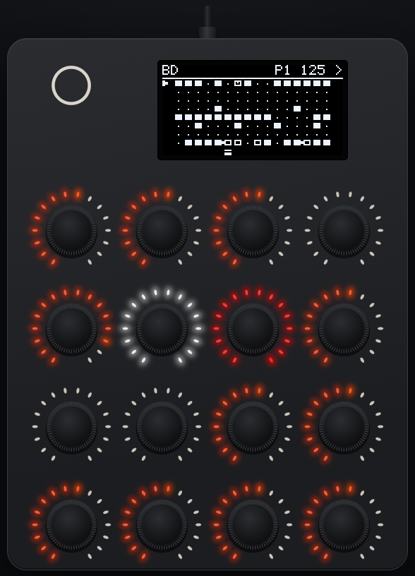
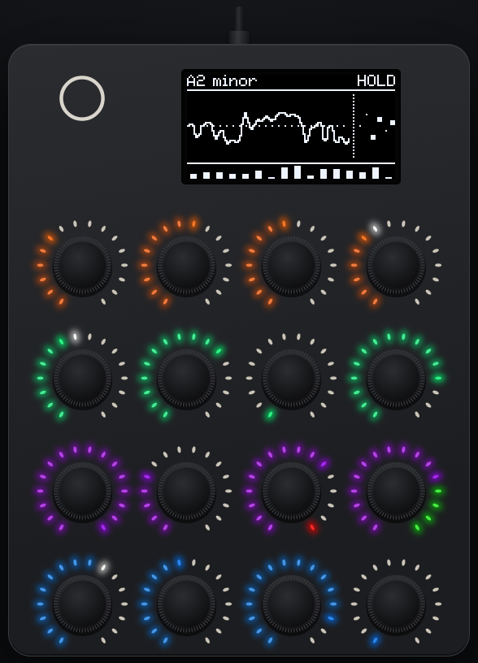
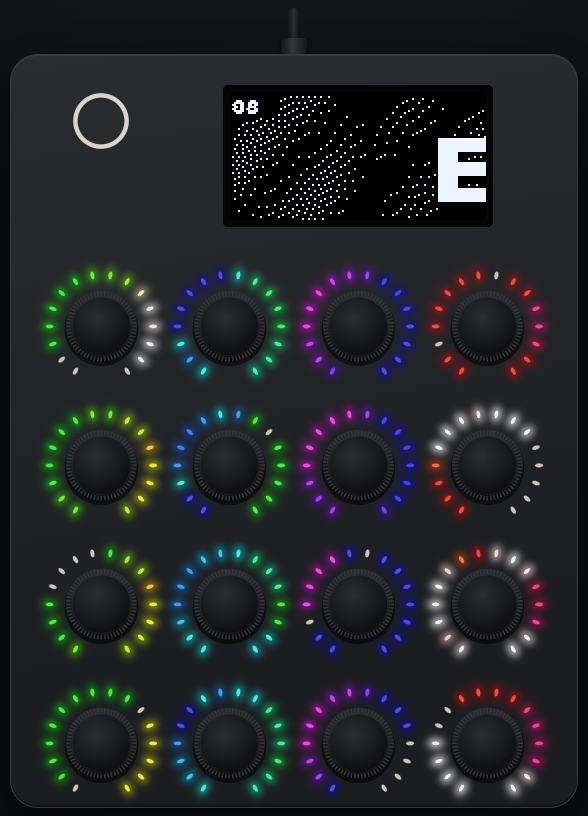
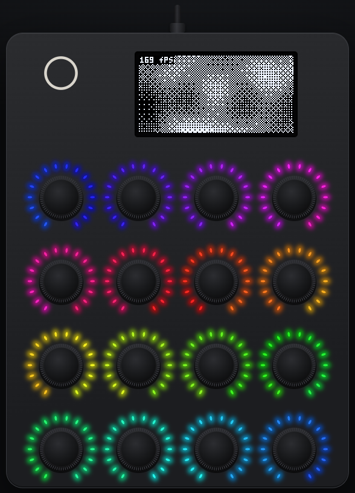

# e16-launcher

Custom firmware for the [OXI E16](https://oxiinstruments.com) MIDI controller
that embeds Lua 5.4 and runs scripts written for the E16's stock Lua API,
plus a disk mode, a few new APIs (screen canvas, per-LED rings, an internal
synth that plays over USB audio), and native C apps that run from
RAM.

What comes with it:

- **Built-in scripts** from [oxi-e16-lua](https://github.com/charlesvestal/oxi-e16-lua) (each one's manual is in
  that README): [Euclid](https://github.com/charlesvestal/oxi-e16-lua#euclid) (Euclidean drum sequencer),
  [LFOx16](https://github.com/charlesvestal/oxi-e16-lua#lfox16) (16 LFOs), [Chords](https://github.com/charlesvestal/oxi-e16-lua#chords) (chord pads),
  [Mod Seq](https://github.com/charlesvestal/oxi-e16-lua#mod-seq) (CC modulation sequencer),
  [Note Seq](https://github.com/charlesvestal/oxi-e16-lua#note-seq) (16-step note sequencer) and
  [TB-3PO](https://github.com/charlesvestal/oxi-e16-lua#tb-3po) (generative acid sequencer), plus the launcher's
  own demos for its new APIs: Canvas, Rings, Acid and MIDI Mon
  (`scripts/demos/`).
- **Native apps** (`apps/`, below): x0x-lite, Drone, a GIF player and
  small demos; [docs/apps.md](docs/apps.md) shows how to write your own.
- **Modes** ([docs/modes.md](docs/modes.md)): Disk mode (the E16 as a USB
  drive), Webcam mode (a USB video synth) and the Mirror (the E16 live in
  a browser, and remote control).

## Native apps

The screenshots are the [Mirror](docs/modes.md#mirror) page showing the
E16 live. Build the apps with `cmake -S apps -B build-apps && cmake --build
build-apps`, copy an `.e16app` to `/apps/` in Disk mode, eject, and start
it from the menu. To go back to the launcher, hold Shift on its own for
5 s and push encoder 1 at the prompt.

<table>
<tr>
<td width="240"></td>
<td>

### [x0x-lite](docs/x0x.md)

A groovebox ported from X0X (the author's TBD-16 groovebox): seven 808
voices (BD, SD, low tom, clap, closed and open hat, cowbell; 8W8's
circuit models) and a 303 (Open303 with Devilfish ranges and RAT drive)
with the TB-3PO line generator, on a 16-step sequencer with 16 patterns,
swing, accent and slide, MIDI clock in and out, and MIDI notes
transposing the 303. The encoders are the 16 steps of the selected
track; Shift + push picks tracks and pages. It plays its factory loop at
launch and uses 41-44% of the CPU. **It is GPL-3.0-only**
(`apps/x0x/LICENSE`), unlike the rest of this repository.
[docs/x0x.md](docs/x0x.md) has the controls, MIDI and CPU measurements;
`docs/audio/x0x-demo.wav` is a 10 s sample.

</td>
</tr>
<tr>
<td width="240"></td>
<td>

### [Drone](docs/drone.md)

An evolving drone synth on the app audio stream: six detuned, drifting
oscillators on a chord over the root, a sine sub and noise, drive into a
resonant filter with a slow LFO, a small freezable reverb, and a limiter;
"evolve" wanders the macros by itself. The 16 encoders are its 16
macros, the rings show them, and the screen shows a scope of the output.
MIDI notes set the root, CCs the macros. About 27% of the CPU.
[docs/drone.md](docs/drone.md) has the controls and the CC map;
`docs/audio/drone-demo.wav` is a 10 s sample.

</td>
</tr>
<tr>
<td width="240"></td>
<td>

### [GIF player](docs/player.md)

`apps/demos/player` plays animations on the OLED, with matching colours
on the LED rings. `tools/gif2e16.py` converts an animated GIF (or any
image or sequence Pillow reads) into the player's `.e16v` format;
encoders pick the file, the speed and the LED brightness.
[docs/player.md](docs/player.md) has the converter's options and where
the files go.

</td>
</tr>
<tr>
<td width="240"></td>
<td>

### Plasma

`apps/demos/plasma`: a dithered plasma/tunnel effect with a 256-LED
rainbow, encoder controls, and an on-screen and logged fps counter. With
`apps/demos/hello` (the smallest app, which exercises every kind of
address the loader rebases) it's the example to start from.

</td>
</tr>
</table>

`apps/tests/` holds apps that check the launcher's guards on the device
(a fault, a flash write, a NULL write, audio overload). How apps are
loaded and run, and what protects the firmware from them, is in
[docs/app-runtime.md](docs/app-runtime.md).

## Quick start

### Build

Firmware (default), cross-compiled for the E16's GD32F405 with the
[E16 SDK](https://github.com/OXI-Instruments/E16-SDK):

```sh
cmake -S . -B build
cmake --build build
```

Output: `build/launcher.bin` (flash this), plus `.elf`, `.hex` and `.syx`.

`E16_DEV_CONSOLE` (default ON) builds in the developer SysEx commands
(virtual controls, screen dump, reset, corrupt-record, PWM-activity probe,
the synth without a script, the noise lab; see
[docs/development.md](docs/development.md)). They let anything with a MIDI
connection poke the UI, so **release builds should turn it off**:
`cmake -S . -B build-release -DE16_DEV_CONSOLE=OFF`. The log, log replay and
reboot-to-bootloader messages stay in either way.

The host build (a native Lua interpreter for the tests) is in
[docs/development.md](docs/development.md#tests).

### Flashing

**First time** (stock firmware, or any firmware that doesn't answer the
SDK's reboot SysEx): with the E16 off, hold encoders 15 and 16 and press
Shift to power on. It shows up as "OXI E16 FW Update", then:

```sh
tools/reflash.sh build/launcher.bin
```

**After that**, with the launcher (or any firmware that answers the reboot
SysEx) already running and connected over USB, the same command reboots it
into the bootloader, uploads, and waits for the launcher's port to come
back. Shift + hold encoder 16 for 2 s also reboots the launcher into the
bootloader without the SysEx round trip.

### Submodules

```sh
git submodule update --init --recursive
```

`external/E16-SDK` is OXI's [E16 SDK](https://github.com/OXI-Instruments/E16-SDK),
which brings its own submodules (ST's CMSIS and HAL, TinyUSB 0.21.0).

## Using the launcher

**Menu**: turn encoder 1 to move the selection, press it to start. Scripts
from `/scripts` on the disk are listed too (marked), and a disk script
replaces a built-in of the same name. A native app (`/apps/*.e16app`,
marked "app") runs in its own clean boot instead of loading into Lua.
After them come "Disk mode" (when the volume is available), which enters
disk mode, and "Webcam", which turns the E16 into a USB camera (see
[docs/modes.md](docs/modes.md)).

**Running a script**, encoders go to the script except for these gestures
(Shift itself never reaches the script, and a press made while Shift is
down is consumed by the UI, release included, so the script never sees
half a press):

| Gesture | Effect |
|---|---|
| Shift tap (release within 1 s, no encoder pressed meanwhile) | opens the page picker: press encoder N to show page N (`page.onPageChange`), or tap Shift again or wait 4 s to close it |
| Shift + press encoder N (while Shift is held down) | shows page N directly, if the script has one, logged as `ui: page N (<name>) via shift+press` |
| **Leaving:** hold Shift on its own (no encoder pushed or turned) for 5 s | a prompt over the screen: push encoder 1 to go back to the menu (unloads the script, saving vars and store); let go of Shift, or wait 4 s, to stay. While it's up, input belongs to the prompt. The same leaves a native app, Disk mode and Webcam mode |
| Shift + hold encoder 16 (alone) for 2 s | reboot into the bootloader, from anywhere |

Turns are dropped while Shift is held — there's no Shift+turn gesture yet.
On the error screen (a script that failed to load), pressing any encoder or
leaving (Shift held 5 s, then encoder 1) returns to the menu.

## Documentation

| | |
|---|---|
| [docs/modes.md](docs/modes.md) | Disk mode, Webcam mode, the Mirror |
| [docs/scripting.md](docs/scripting.md) | writing scripts: disk script headers, the launcher's Lua APIs (`draw`, `ring`, `audio`, MIDI in, `launcher`) |
| [docs/usb-audio.md](docs/usb-audio.md) | the USB audio input, and the optional TRS 2 audio |
| [docs/apps.md](docs/apps.md) | writing a native app |
| [docs/app-runtime.md](docs/app-runtime.md) | how native apps are loaded and run: format, ABI, app audio, capacities, faults, trust |
| [docs/x0x.md](docs/x0x.md), [docs/drone.md](docs/drone.md), [docs/player.md](docs/player.md) | the apps' manuals |
| [docs/safety.md](docs/safety.md) | internal flash, SPI flash wear, persistence records, the flash map |
| [docs/development.md](docs/development.md) | the dev console, the noise lab, tests and the host harness |
| [docs/internals.md](docs/internals.md) | how it works: layers, boot and main loop, memory, where to look |
| [docs/compat-notes.md](docs/compat-notes.md) | where this runtime was checked against the stock mock |
| [docs/hw-acceptance.md](docs/hw-acceptance.md) | what was tested on hardware, and what still needs a human |

## USB name

The launcher shows up as "E16 Launcher". macOS caches MIDI port names per
device, so a Mac that has seen the E16 under another name ("E16 Custom",
"OXI E16") keeps showing that name until the device is removed in Audio MIDI
Setup (Window > Show MIDI Studio, select the E16, delete) and plugged in again.
The tools find the port either way.

## License

MIT (`LICENSE`), except `apps/x0x/` (x0x-lite), which is GPL-3.0-only
because it's ported from GPL code (`apps/x0x/LICENSING.md`).
Third-party components keep their own licenses, listed in `NOTICE`; among
them `tb3po.lua` in `external/oxi-e16-lua` is GPL-3.0, and it's built into
the firmware image. The E16 SDK (`external/E16-SDK`) is OXI Instruments'
own, under its own MIT license.

Written with Claude Code under the author's direction, and tested on E16
hardware.
