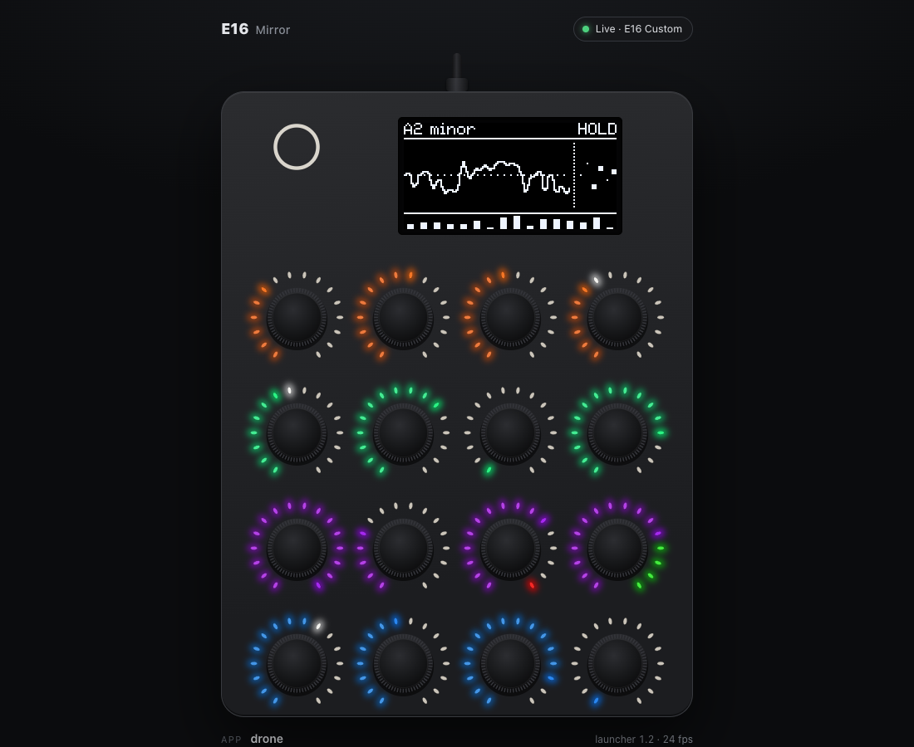

# Modes

Besides running scripts and apps, the launcher's menu has two modes, and the Mirror works in all of them.

- [Disk mode](#disk-mode): the E16 as a USB drive
- [Webcam mode](#webcam-mode): a USB video synth
- [Mirror](#mirror): the E16 live in a browser, and remote control

## Disk mode

Selecting "Disk mode" from the menu unloads any running script (saving its
state first) and presents the E16's SPI flash as a USB drive. On macOS it
mounts as `/Volumes/E16`, holding `/scripts` (the six built-in scripts
plus the canvas/rings/acid/midimon demos, each with a `--@scene` header) and
`/apps` (native apps), plus a `README.TXT` at the root that documents the
header format on the device itself.

Leave disk mode by ejecting the volume on the computer, pressing encoder 1,
or leaving from the prompt (Shift held 5 s, then encoder 1). Leaving flushes the block cache, remounts the
firmware's own view of the volume, and rescans `/scripts` and `/apps` for
the menu. Outside disk mode the volume isn't presented at all — the Mac
shows nothing to mount.

On Windows and Linux, the auto-exit-on-eject heuristic (watching FAT16's
clean-shutdown bit, since macOS's manual-eject path sends no SCSI eject
command) hasn't been tried — see [hw-acceptance.md](hw-acceptance.md)'s "Needs a human"
section. Encoder 1 or a Shift hold always works regardless of platform.

**Wear**: it's FAT on raw NOR with no wear leveling, fine for copying
scripts now and then but not for heavy or constant rewriting. Persistence
(vars/store) never writes into the FAT volume's region — see
[safety.md](safety.md).

## Webcam mode

Selecting "Webcam" from the menu turns the E16 into a USB video synth: it
re-enumerates (it disappears from the computer for about half a second) as
USB MIDI plus a UVC camera, "E16 Launcher" (or the name macOS cached),
160x120 at 20 fps, uncompressed YUY2. Any video app sees it: Photo Booth,
QuickTime, OBS, a browser, or

```sh
ffmpeg -f avfoundation -framerate 20 -video_size 160x120 -pixel_format yuyv422 \
    -i "E16 Launcher" -t 10 out.mp4
```

Leave by holding encoder 1 for 1 s, or from the leave prompt (Shift held 5 s, then encoder 1): the E16 re-enumerates
back to MIDI + Disk mode's mass storage + USB audio, on the menu. While the
camera is on there's no mass storage and no USB audio input (the GD32's USB
core has the packet memory for MIDI + video or for the rest, not both); the
synth is silent meanwhile, and USB MIDI, the dev
console and the log keep working.

**Encoders** (turn = change, press = back to the default, except encoder
1's short press, which switches the OLED between status + a small dithered
mirror of the picture and a full-screen mirror):

| | 1 | 2 | 3 | 4 |
|---|---|---|---|---|
| **row 1** | pattern: plasma, tunnel, rings, bars, spiral, checks | hue | speed | zoom |
| **row 2** | pattern B | mix: how much of B (0-16) | mix mode: blend, add, xor, wipe | symmetry: off, mirror, quad, kaleidoscope |
| **row 3** | palette: rainbow, fire, ice, neon, mono | colour cycling (-16..16) | posterize (off, 2-16 bands) | contrast |
| **row 4** | brightness | warp (sideways wobble per line) | text overlay: off, the pattern names, the last MIDI note, "OXI E16" | scanlines (0-3) |

The OLED's status shows the stream state ("LIVE" with the frame rate, "NO
APP" while nothing captures), the patterns and the setting last changed;
the LED rings show the picture's colours on a 4x4 grid, each with a white
dot at its encoder's setting. The settings last until a reset.

**MIDI in** (USB or TRS, any channel): a note-on jumps the hue to the
note's pitch class and flashes the picture towards white by its velocity
(and shows the note name with the text overlay on "note"); CC 20-35 set
settings 1-16 across their range; CC 1 sets the mix; a program change
picks pattern A.

**How**: `usb_video_select()` (usb_video.h, from the SDK's `examples/usb_cam`) switches the USB
configuration at run time. There's no frame buffer: the picture is made a
line at a time from tables (`src/webcam/wc_render.c`), by a lowest-priority
interrupt that stays up to 12 lines ahead of the USB interrupt sending
them. 20 fps with any settings, at 21% of the CPU (one pattern) to 45%
(two patterns, kaleidoscope, warp); the log has `webcam: 10000 ms: ...`
every 10 s while the computer captures. Its ~23 KB of tables, palettes and
line buffers come from the Lua heap (free while no script runs) and go
back on leaving. `src/webcam/webcam.h` has the details.

## Mirror



A live view of the E16 in a browser, over the same USB MIDI cable: the
OLED pixel for pixel, the 16 LED rings in their colours, and every turn,
push and Shift press, on the E16 or from the page. The page can drive the
E16 too: scroll or drag on a knob to turn it, click to push, hold to keep
it pushed, hold the round "O" at the top left for Shift. It works in every
mode (the menu, scripts, native apps, Disk mode, Webcam mode).

Open it in Chrome or Edge (Web MIDI with SysEx; Safari and iOS browsers
have no Web MIDI, Firefox asks to install a site permission), and allow
MIDI when asked. Any of:

- **From the E16's disk**: the launcher keeps a copy at the root of its
  disk, `mirror.html` (written at boot when it's missing or differs from
  the firmware's copy, so it always matches the firmware). Enter Disk
  mode, copy it to the computer or open it from there (`file://` pages
  count as secure, so Web MIDI works).
- **From the repo**: open `tools/mirror/index.html` as a file, or run
  `tools/mirror/serve.sh` and open `http://localhost:8016/`.
- `index.html?demo` shows animated sample data without an E16.

**The page**: the drawn E16 (the screenshot above) with
the OLED, the 16 rings in their colours and the Shift button. Above it, a
status pill: "Live · <port name>", "Demo", or what's wrong, with a note
on how to fix it (no Web MIDI in this browser, MIDI access blocked, the
E16 not connected or not streaming, a page not opened from localhost or a
file). Below it, the current mode (menu,
script, app, Disk mode, Webcam) with what's selected or running, the
launcher's version and the mirror's frame rate, and an **Events** list
of the latest turns, pushes and Shift presses, the ones made from the
page marked as remote. Controls:

| | on the page |
|---|---|
| turn | scroll on a knob, or drag up/down |
| push | click a knob; hold to keep it pushed |
| Shift | hold the round "O" at the top left |
| keyboard | Tab to a knob, arrow keys to turn, Space to push |

**Settings** (the fold-out under the events, kept in the browser):
"LED 1 of each ring" picks where a ring's first LED sits, at 7 o'clock
running clockwise (the default) or at 5 o'clock running
counter-clockwise. The launcher fills rings from LED 1 clockwise, like a
knob's travel; OXI hasn't confirmed the physical order, so if the rings
on the page run the other way round than on your E16, flip this.

The page finds the ports by name ("E16 Launcher" or "E16 Custom"). The
stream runs only while something subscribes and keeps it alive (the page
sends a keepalive every second while it's visible; the E16 stops by
itself 3 s after the last one), so a closed tab costs nothing.

**What it costs**: the OLED goes in 32-column segments only when they
change, at most ~30 times a second; the rings likewise; events at once.
Every write is a try, so the stream never waits for USB: with the queue
full it carries on at the next pass. Measured on the device: 30.3 fps
with the Drone app animating (~17 KB/s) and no USB audio underruns over
30 s; 12.6 fps in Webcam mode, where all 16 rings change constantly
(~31 KB/s in all); the longest mirror poll ~1.0-1.3 ms including
interrupts. `tools/mirror/mirror_client.py` is a command-line client
(events, the OLED as PNG or text art, ring levels, remote actions); the
launcher logs `mirror: 10000 ms: ...` every 10 s while it streams.

**Protocol**: SysEx in the dev console's framing (`F0 7D 45 <cmd> ...
F7`): `20` subscribe/keepalive, `21` unsubscribe, `10` a virtual control
(as in `src/console.h`); the E16 sends `70` state, `71` an OLED segment,
`72` a ring, `73` an input event, `74` end of frame.
`src/mirror/mirror_core.h` has the details.

**Security**: while the mirror is built in, anything on the computer that
can send MIDI to the E16 can watch it and drive it (turn, push, Shift),
like the dev console's virtual controls. It's the CMake option
`E16_MIRROR` (default ON), independent of `E16_DEV_CONSOLE`; build with
`-DE16_MIRROR=OFF` to leave it (and the page on the disk) out.
