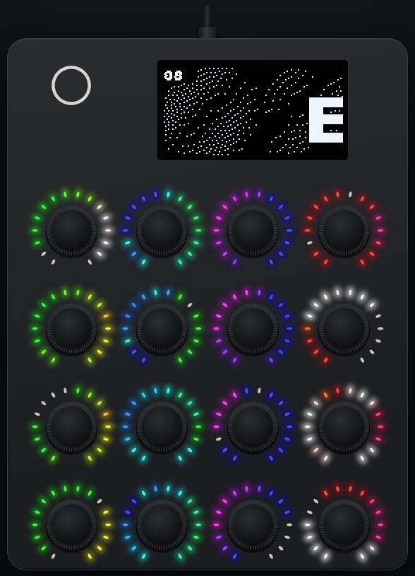

# GIF player



`apps/demos/player` plays animations on the OLED, with matching colours on
the LED rings. `tools/gif2e16.py` (needs Pillow) converts an animated GIF,
or any image or image sequence Pillow reads, into the player's `.e16v`
format. Each frame is stored ready to send to the screen at 128×64 1-bit,
along with 16×16 LED colours and its own delay:

```sh
tools/gif2e16.py cat.gif cat.e16v                    # letterbox, Floyd–Steinberg
tools/gif2e16.py cat.gif cat.e16v --fill --invert    # crop to fill; swap lit/dark
tools/gif2e16.py cat.gif cat.e16v --threshold 100    # hard threshold, no dither
tools/gif2e16.py cat.gif cat.e16v --preview cat.png  # the OLED ×4 + rings (.gif: animated)
```

Copy `player.e16app` to `/apps/` and the `.e16v` files to `/apps/player/`
in Disk mode. The app API can't list a folder, so the player plays the
files named in `/apps/player/playlist.txt`, one name per line.
`tools/gif2e16.py --playlist /Volumes/E16/apps/player` writes that list
for every `.e16v` already there. Then eject and start "player" from the
menu. It loops the first file. If it finds nothing playable, the screen
says where the files go.

| Control | Effect |
|---|---|
| encoder 1 (turn) | next / previous file |
| encoder 2 (turn) | speed, 25%–400% |
| encoder 3 (turn) | LED brightness, off–8 (default 3) |
| encoder 4 (press) | pause / resume |
| Shift held 1 s | back to the launcher |

The player logs `player: <file> N frames, X fps` every 5 s. The rings are
laid out as a 4×4 grid over the picture, and each ring shows the colours
around its own cell (the docstring in `tools/gif2e16.py` has the mapping
and the file format). `test/player/make_test_gifs.py` builds two test
animations into `build-player/`, and `test/player/match_dump.py` checks a
`tools/console.py screen` dump against an `.e16v`'s frames.
